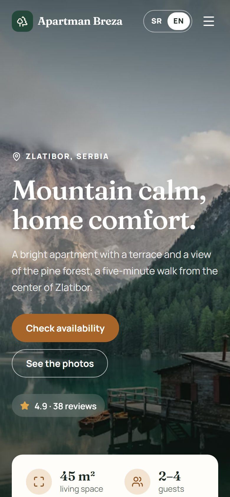

# Apartman Breza – holiday apartment landing page

A bilingual (Serbian / English) landing page for a small holiday rental on Zlatibor, Serbia: gallery, seasonal prices, guest reviews, map and an inquiry form that estimates the price of the stay.

**Live demo:** https://danilo3110.github.io/apartment-landing-demo/


<p align="center"></p>

## Features

- **Two languages** with [react-intl](https://formatjs.github.io/docs/react-intl/): correct Serbian plural forms ("1 gost, 2 gosta, 5 gostiju"), prices and dates formatted per language, remembered language choice, Serbian by default for visitors from the region.
- **Inquiry form** with validation, a suggested departure date and a live price estimate. Stays that cross two seasons are priced night by night.
- **Gallery** in a native `<dialog>`: keyboard navigation, Esc to close, focus returns to the thumbnail, low-res preview while the full image loads.
- **Seasonal price cards** that highlight the current season automatically.
- **SEO basics:** meta description, Open Graph, schema.org `LodgingBusiness`, sitemap and robots.txt.
- **Responsive and accessible:** skip link, ARIA labels, visible focus, `prefers-reduced-motion`.
- Hand-written SCSS, no UI library.

## Tech stack

React 19 · Vite · SCSS · react-intl · lucide-react

## Getting started

```bash
npm install
npm run dev        # http://127.0.0.1:5180
npm run build      # production build in dist/
```

On Windows you can also double-click `start.cmd`.

## Project structure

```
src/
  components/      page sections (Hero, Gallery, Prices, Contact, ...)
  data/            apartment content: photos, amenities, seasons, reviews
  i18n/            Serbian and English messages, language provider
  styles/          SCSS partials and design tokens
  utils/           stay/price calculation, inquiry validation and sending
```

## Deployment

- **GitHub Pages:** `npm run deploy` builds the site and publishes `dist/` to the `gh-pages` branch. On GitHub Pages the inquiry form runs in demo mode (it shows a confirmation but does not send anything).
- **Netlify:** `netlify.toml` is included. On Netlify the inquiry form is submitted through Netlify Forms.

## Notes

This is a demo project: the apartment, prices, contact details and reviews are fictional. Photos are from [Unsplash](https://unsplash.com).

© 2026 Danilo Lukić. All rights reserved.
